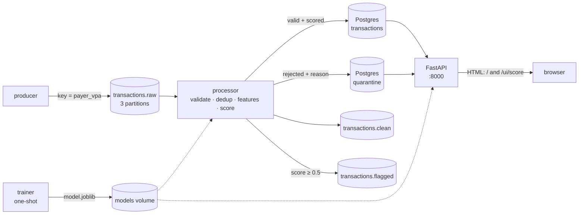

# LEARNING.md: Project 1 study guide

<!-- How the whole project works, file by file, with exercises and interview prep. Every number
     in this file comes from ONE run of ./scripts/measure_all.sh, saved in results/measured_run.txt. -->

Real-time UPI-style transaction pipeline with fraud detection: a simulator → Kafka → a processor that
validates, deduplicates and scores each transaction → PostgreSQL → a FastAPI service.

**Every number below comes from a single run:**
```bash
./scripts/measure_all.sh        # ~10-15 min; deletes existing pipeline data first; output -> results/measured_run.txt
```
Section 7 shows that run's results and how to read them.

---

## 1. Architecture and the life of one transaction



**One transaction, step by step**
1. **Training (once, at start-up).** The `trainer` container simulates 200,000 labelled transactions, computes features with `model/features.py`, trains three models, keeps the best by validation F1, and writes `model.joblib` to the shared `models` volume. The processor and API only start after it exits successfully (`service_completed_successfully`).
2. **Produce.** `producer/main.py` calls `generator.next_batch()`. Usually that's one normal payment. About 2% of transactions belong to a fraud pattern, and some events are deliberately dirty. The record is sent as JSON to `transactions.raw` with **key = payer VPA**, so all of one user's payments land on the same partition, in order.
3. **Kafka stores it.** The broker appends it to one partition's log at the next **offset**. The message stays there whether or not anyone reads it.
4. **Consume.** `processor/pipeline.py` (consumer group `processor`) reads up to 100 messages with `consume()`.
5. **Validate and clean.** `validate.validate()` parses the JSON, checks the 8 required fields, lowercases and trims the VPAs, then checks VPA format, self-payment, amount and timestamp. A failure is stored in `quarantine` with its reason and Kafka position.
6. **Features.** `store.fetch_history()` loads this payer's newest 100 earlier transactions (index on `(payer_vpa, ts)`), and `features.compute_features()` turns them into 7 numbers. This is the *same function* the trainer used.
7. **Score.** `scorer.score()` returns the model's fraud probability, and `flagged = score >= 0.5`.
8. **Store, idempotently.** `store.save_txn()` runs `INSERT … ON CONFLICT (txn_id) DO NOTHING`. If the id already exists, it compares the stored (partition, offset): the same offset means a Kafka **redelivery** (skip), and a different offset means a **genuine duplicate** (quarantine `duplicate_txn_id`).
9. **Commit in the safe order.** First the DB commit, then produce to `transactions.clean` (and `transactions.flagged` if flagged) and `flush()`, and only then `consumer.commit()`. A crash before the last step means Kafka re-sends the batch, and step 8 makes that harmless.
10. **Serve.** `GET /transactions/flagged` lists it if it was flagged, `GET /stats` counts it, and `POST /score` can score a *new* transaction for the same payer, using this one as history.
11. **See it.** Within 5 s the dashboard at `/` reloads. Its counters include this txn, and if it was flagged it appears in the "Latest flagged" table. Both come from `read_stats()` and `read_flagged()`, the same functions behind the JSON routes.

---

## 2. Every file: purpose and the concept it demonstrates

| File | Purpose | Key concept |
|---|---|---|
| `docker-compose.yml` | Starts Kafka, kafka-init, producer, Postgres, trainer, processor, api | Service dependencies (`service_healthy`, `service_completed_successfully`), volumes, listeners |
| `.env.example` | Documents every setting (rates, users, DB credentials) | Config via environment, no secrets in git |
| `.dockerignore` | Keeps `.venv`, `.git`, tests out of image builds | Small, fast build contexts |
| `pyproject.toml` | ruff and pytest configuration | Linting, test discovery |
| `requirements-dev.txt` | Everything needed to lint and test on the Mac / in CI | One install command for developers |
| `producer/generator.py` | Users, merchants, normal txns, 4 fraud patterns, 4 dirty types | Pure, seeded, testable data generation; `FRAUD_RATE` as share of txns |
| `producer/main.py` | Sends generated txns to Kafka at a fixed rate | Message keys, `acks=all`, idempotent producer, `flush()` on SIGTERM |
| `producer/Dockerfile` | Producer image | Layer caching, exec-form CMD (PID 1 receives signals) |
| `processor/validate.py` | Raw bytes → clean txn, or a rejection reason | Validate vs clean vs reject; NaN/bool edge cases |
| `processor/store.py` | History query, idempotent inserts, quarantine | `ON CONFLICT DO NOTHING`, redelivery vs duplicate |
| `processor/pipeline.py` | Consumer loop: validate → score → store → forward → commit | Consumer groups, manual offset commits, at-least-once, crash-only design |
| `processor/Dockerfile` | Processor image, built from the repo root | Sharing code between services |
| `model/features.py` | 7 features from a txn and the payer's earlier txns | Feature engineering; one function for training and serving |
| `model/train.py` | Simulate data, time-ordered split, train 3 models, report P/R/F1 | Class imbalance, class weights, validation vs test, no accuracy |
| `model/scorer.py` | Load the bundle, score one txn | Model serving; fixed feature order |
| `model/Dockerfile` | Trainer image (one-shot job) | Batch jobs inside compose |
| `api/app.py` | `/health`, `POST /score`, `/stats`, `/transactions/flagged`, plus HTML pages `/` and `/ui/score` | Model serving over HTTP, strict validation, connection pool, 422 vs 503; one function per query shared by JSON and HTML |
| `api/templates/base.html` | Shared layout: nav bar and CSS | Template inheritance (`extends` / `block`) |
| `api/templates/dashboard.html` | Stat cards, rejections by reason, newest flagged txns | Server-side rendering, meta-refresh polling |
| `api/templates/score.html` | GET form, then score + features or the rejection reason | HTML forms, GET for read-only actions, autoescaping (XSS) |
| `api/Dockerfile` | API image (uvicorn) | Healthcheck with the stdlib |
| `db/schema.sql` | `transactions` + `quarantine` tables and indexes | PK as durable dedup, NUMERIC money, CHECK, partial index |
| `benchmark/throughput.py` | Backlog of 20,000 messages → time to drain | Measuring throughput honestly (start-up included) |
| `benchmark/api_latency.py` | 1,000 sequential `POST /score` → p50/p95/p99 | Latency percentiles, keep-alive |
| `scripts/measure_all.sh` | One fresh run that produces every documented number | Reproducible results |
| `results/measured_run.txt` | Output of that run | Evidence for every metric |
| `.github/workflows/ci.yml` | ruff + pytest on every push, with a Postgres service | CI, service containers, `REQUIRE_DB=1` |
| `tests/conftest.py` | Real-Postgres fixture, rolled back after each test | Integration tests that leave no data |
| `tests/test_generator.py` | Fraud/dirty shapes, rates, determinism | Testing generated data |
| `tests/test_validate.py` | One test per rule; every generator dirty type is caught | Contract between producer and processor |
| `tests/test_store.py` | Inserts, redelivery vs duplicate, history, CHECK constraint | Idempotency, defence in depth |
| `tests/test_features.py` | Each feature, cold start, window boundary, "only earlier" | Leakage-free features |
| `tests/test_train.py` | Metrics present, weights raise recall, deterministic | Testing ML code |
| `tests/test_pipeline.py` | `process_batch` with fake Kafka messages + stub model | Testing a consumer without Kafka |
| `tests/test_api.py` | Every endpoint, wrong types, DB outage → 503; HTML pages render, show reasons, escape `<script>` | TestClient, monkeypatch, testing HTML output |

---

## 3. Core concepts, tied to the code

### Kafka: topics, partitions, consumer groups, offsets
- **Topic.** A named, append-only stream: `transactions.raw`, `.clean`, `.flagged`, created by `kafka-init`.
- **Partition.** A topic is split into ordered logs (3 here). Order is guaranteed only *within* a partition, which is why `producer/main.py` uses `key=payer_vpa`: `hash(key) % 3` puts all of one payer's payments in one partition, in order. The features in step 6 depend on that order.
- **Offset.** The position of a message in its partition. Kafka doesn't delete messages when they're read. Each consumer group stores how far it got (its *committed offset*).
- **Consumer group.** `group.id: "processor"`. The group's members share the partitions, and each partition belongs to exactly one member. So 3 partitions means at most 3 processors working in parallel. A *different* group (say, an analytics job) would get its own complete copy of the stream. That's a big reason to use Kafka rather than a queue, where a message is gone once someone takes it.
- **KRaft.** Kafka stores its own metadata (no ZooKeeper): `KAFKA_PROCESS_ROLES: broker,controller`.
- **Listeners.** Containers connect to `kafka:9092` and your Mac to `localhost:9094`. The broker tells each client which address to reconnect to (the *advertised* listener), so it must be reachable from where that client runs.
- **Session timeout.** A consumer that dies without leaving the group keeps its partitions until `session.timeout.ms` (45 s default) expires. The measured run shows this: section 7, "seconds from SIGKILL until processing resumed". A graceful stop calls `consumer.close()` and hands the partitions over immediately.

### At-least-once delivery, and why dedup is needed
- `enable.auto.commit=False`, and the order in `pipeline.py` is: DB commit → produce + flush → `consumer.commit()`. If the process dies anywhere before the last step, those messages are delivered again. **You may see a message twice, but you never lose one.**
- *At-most-once* is the opposite order (commit offsets first). A crash then silently loses data, which is unacceptable for payments.
- Redelivery is only safe if processing is **idempotent**. The `txn_id` PRIMARY KEY and `UNIQUE(kafka_partition, kafka_offset)` turn "delivered twice" into "stored once". The measured run replays the *entire* topic and checks that not a single row is added.
- Dedup also handles a different problem: **genuine duplicates** (the same `txn_id` in two different messages, e.g. an app retry). Storing (partition, offset) on each row is how `store.save_txn` tells the two apart.
- Effectively-once results = at-least-once delivery + idempotent writes. The `clean`/`flagged` topics are still at-least-once, so their readers must dedupe by `txn_id` too.

### Data validation and cleaning
- **Clean** what can be fixed without guessing (VPA case and whitespace). **Reject** what can't (a missing amount can't be invented). **Quarantine** rather than drop: bad data stays visible, countable (`/stats`) and replayable after a bug fix.
- Edge cases a naive check misses, each with a test: `True` is an `int` in Python; `NaN` passes neither `> 0` nor `<= 0`; a timestamp without a timezone is ambiguous; `"100"` is not a number.
- **Defence in depth:** `CHECK (amount > 0)` and `NUMERIC(12,2)` in the schema still protect the data if `validate.py` has a bug.
- Fraud is **not** dirty data. `test_fraud_records_are_not_rejected` makes sure cleaning never throws away the suspicious-but-valid records.

### Feature engineering
Seven features per transaction (`model/features.py`), all from the payer's **earlier** transactions:

| Feature | Catches |
|---|---|
| `txn_count_5min` | bursts (rapid repeats, fan-out) |
| `distinct_payees_5min` | fan-out to many people vs repeats to one |
| `amount_vs_avg` | unusually large amount for this user |
| `is_new_device` | account takeover (only when there is history) |
| `log_amount` | large amounts even without history |
| `log_secs_since_last` | bursts are 0.1–0.9 s apart, normal users pay every few minutes |
| `history_count` (capped at 10) | how much to trust the two history-based features |

- **No train/serve skew:** training and serving call the same `compute_features`. Only the source of history differs (an in-memory list vs a SQL query), and both mean "this payer's earlier txns, `ts <` this one, newest 100".
- **No leakage:** a txn never sees itself or the future (`h["ts"] < ts`, tested). Labels (`is_fraud`) are stored for evaluation and never used as features.

### Precision vs recall (and why recall matters for fraud)
- **Precision** = of the flagged txns, the share that really were fraud. **Recall** = of the real fraud, the share we flagged. **F1** = their harmonic mean.
- For fraud, **recall matters most**: every missed fraud is real money lost and a victim. A false alarm costs a step-up check (an OTP, a call). But precision can't be ignored, because too many false alarms annoy customers and train analysts to ignore alerts.
- **Accuracy is useless here.** With ~2% fraud, "never flag anything" is ~98% accurate and catches nothing. `train.py` prints that majority baseline on purpose.

### Class imbalance
- `FRAUD_RATE=0.02` makes about 2% of *transactions* fraud. `next_batch` converts that into how often a burst starts, using the average burst size.
- `class_weight="balanced"` weights each class inversely to its frequency, so a missed fraud row costs ~49× a false alarm in the loss. The trainer reports the same logistic regression **with and without** weights, so you can see recall rise and precision fall.
- **Time-ordered split (60/20/20):** train on the past, choose the model on the next period (validation), report on the latest (test). The model is never chosen by its test score.

### Model serving
- The model is trained once into a volume and **loaded once** per process (processor start-up, API `lifespan`), not per request.
- The bundle stores `feature_names` and `threshold` with the model, so a feature-order mismatch can't happen.
- scikit-learn, numpy and scipy are pinned identically in every image, because a pickle loaded by another version may break.
- In the processor, scoring happens **inside the DB transaction**, so earlier txns of the same batch count as history (`test_earlier_txns_in_the_same_batch_count_as_history`).
- The API uses a connection pool, strict Pydantic input, the pipeline's own validation, and correct status codes (422 = bad input, 503 = DB down).

### Web pages: server-side rendering (Phase 6)
- **Server-side rendering.** The server builds the full HTML and the browser only displays it. `templates.TemplateResponse(request, "dashboard.html", {...})` fills a Jinja2 template with Python data. The alternative, a JavaScript app (React etc.) that fetches JSON, needs a second toolchain. For two read-mostly pages that would be all cost and no benefit.
- **One source of truth.** `read_stats()`, `read_flagged()` and `score_clean()` are plain functions. The JSON routes and the HTML routes both call them, so the page can't show a different number from the API.
- **Template inheritance.** `base.html` defines the nav and CSS once, with empty ``s. `dashboard.html` and `score.html` `` it and fill the blocks.
- **Autoescaping = XSS defence.** Every `{{ value }}` is HTML-escaped, so `<script>` becomes `&lt;script&gt;` and is shown as text. Without it, anyone who could get a string into the database (a VPA, a location) could run JavaScript in the browser of whoever opens the dashboard. `test_score_page_escapes_html` proves it.
- **Polling without JavaScript.** `<meta http-equiv="refresh" content="5">` makes the browser reload every 5 s. Each reload runs two small queries (the flagged one uses the partial index). For true push you'd use WebSockets or Server-Sent Events, which need JavaScript.
- **GET vs POST for the form.** GET is for reads that change nothing, and scoring stores nothing, so the form uses `method="get"` and the values arrive as query parameters (bookmarkable, safe to repeat). Changing data would require POST, and in FastAPI a POST form also needs the `python-multipart` package.
- **Form values are text.** A browser sends `amount=450` as the string `"450"`. The page converts it with `float()` (failure → `bad_amount`), turns empty boxes into missing fields, then runs the *same* `validate.validate()` as the pipeline.

### Docker and CI
- One command (`docker compose up --build`) builds 4 images and starts 7 services in dependency order. Healthchecks gate start-up.
- The CI workflow runs ruff and pytest against a real Postgres service container. `REQUIRE_DB=1` makes DB tests *fail* rather than skip if the database is missing.

---

## 4. Ten "break it to learn it" exercises

1. **Remove the message key.** In `producer/main.py` set `key=None`, rebuild, and consume with `--property print.partition=true`.
   *What goes wrong:* one user's payments spread over all 3 partitions.
   *Why:* without a key, the client spreads messages for balance. Per-user ordering, which the features depend on, is lost, and with several processors one user's history would be split across machines.
2. **Break the advertised listener.** Change `EXTERNAL://localhost:9094` to `EXTERNAL://kafka:9094` and run `benchmark/throughput.py`.
   *What goes wrong:* the client connects once, then fails with "Failed to resolve 'kafka:9094'".
   *Why:* bootstrap only returns metadata. Clients then reconnect to the *advertised* address, and your Mac can't resolve the Docker-internal name `kafka`.
3. **Commit offsets before the DB write.** Move `consumer.commit(asynchronous=False)` to just after `consume()` and add `raise RuntimeError("boom")` after `process_batch(...)`.
   *What goes wrong:* the accounting check fails, with fewer rows than raw messages.
   *Why:* offsets were committed for a batch whose DB transaction rolled back, so on restart Kafka skips it and the records are lost (at-most-once).
4. **Remove idempotency.** Drop `PRIMARY KEY` from `txn_id` in `db/schema.sql` and `ON CONFLICT (txn_id) DO NOTHING` from `store.py`. Then `down -v`, `up`, and reset the processor's offsets to the start.
   *What goes wrong:* every transaction is stored twice (`count(*) - count(DISTINCT txn_id)` > 0).
   *Why:* at-least-once delivery without idempotent writes means duplicates.
5. **SIGKILL vs graceful stop.** Compare `docker compose kill processor; docker compose start processor` with `docker compose stop processor; docker compose start processor`, watching `kafka-consumer-groups.sh --describe --group processor`.
   *What you'll see:* after a kill, processing pauses for about the session timeout. After a stop, it resumes almost immediately.
   *Why:* a killed consumer never says goodbye, so the group waits until its session expires before reassigning its partitions.
6. **Run more processors than partitions.** `docker compose up -d --scale processor=4`, then describe the group.
   *What you'll see:* 3 consumers own one partition each and the 4th owns none.
   *Why:* within a group a partition has exactly one owner. Partitions cap parallelism, so for 10,000 TPS you'd plan the partition count up front.
7. **Remove the class weights.** Delete `class_weight="balanced"` from the random forest in `train.py` and run `PYTHONPATH=producer python model/train.py`.
   *What happens:* test recall drops and precision rises.
   *Why:* with 98% non-fraud rows, the cheapest way to lower the loss is to say "not fraud" more often.
8. **Create train/serve skew.** Change `h["ts"] < ts` to `<=` in `features.py` and `ts < %s` to `<=` in `store.fetch_history`. Rebuild, then replay.
   *What goes wrong:* replayed txns get a `txn_count_5min` one higher than the first time.
   *Why:* offline, a txn is added to history after it's scored. Online, on a replay, it's already in the DB, so `<=` counts it as its own history.
9. **Turn off strict input.** Remove `strict=True` from `Transaction` in `api/app.py` and `POST /score` with `"amount": "100"`.
   *What goes wrong:* the request is accepted, because Pydantic silently converts the string.
   *Why:* lax mode coerces types. For money it's safer to reject ambiguous input.
10. **Open a DB connection per request.** In `/score`, replace `state["pool"].connection()` with `psycopg.connect(os.environ["DATABASE_URL"])` and rerun `benchmark/api_latency.py`.
    *What goes wrong:* p50 latency goes up several-fold.
    *Why:* every request now pays for a TCP connect plus PostgreSQL authentication before doing any work. Pools exist to pay that cost once.

### Bonus exercises: the web pages (Phase 6)

11. **Turn off autoescaping.** In `score.html` change `{{ value }}` in the `<input>` to `{{ value|safe }}`, then open `/ui/score?location="><script>alert(1)</script>` (fill the other fields too).
    *What goes wrong:* an alert box pops up, and `test_score_page_escapes_html` fails.
    *Why:* `|safe` tells Jinja2 "this is trusted HTML". The quote closes the `value="..."` attribute and the script tag becomes real HTML. That's reflected XSS.
12. **Switch the form to POST.** Change `method="get"` to `method="post"` and read the fields with `Form(...)` parameters instead of `request.query_params`.
    *What goes wrong:* FastAPI fails with an error that `python-multipart` must be installed. After you install it, refreshing the result page makes the browser ask to "resubmit the form".
    *Why:* form bodies need a parser that FastAPI doesn't ship with, and browsers treat POST as possibly changing data, so they won't silently repeat it.
13. **Typo a template variable.** In `dashboard.html` change `stats.flagged` to `stats.flaged`.
    *What goes wrong:* nothing crashes. The card is just empty.
    *Why:* Jinja2's default "undefined" renders as an empty string. That's forgiving for pages but hides bugs. Tests have to check for real values in the HTML (as `test_dashboard_renders_stats_and_flagged_row` does for a flagged row), not just for status 200. (`jinja2.StrictUndefined` would make it raise instead.)

---

## 5. 25 interview questions, with model answers from this code

1. **Why Kafka instead of a simple queue or a database table?**
   Kafka keeps messages after they're read, so several independent consumer groups can each read the full stream (processor today, analytics or a second model tomorrow), and you can **replay** history (I reset offsets and reprocessed everything). Partitions give ordered, parallel processing per key. A queue deletes a message once consumed, and a DB table used as a queue means polling, locking and no built-in partitioned ordering.
2. **What happens if the consumer crashes mid-stream?**
   Offsets are committed only after the DB commit and the forward to the clean topic. A crash before that means the uncommitted batch is redelivered when it restarts. The DB transaction for the half-done batch rolls back, and redelivered messages hit `ON CONFLICT DO NOTHING`, so nothing is lost and nothing is stored twice. I tested it with SIGKILL: the accounting check `raw = transactions + quarantine` still held, with zero duplicate txn_ids. The cost is a pause of about the session timeout before the group reassigns the partitions.
3. **How would this scale to 10,000 TPS?**
   First, more partitions (e.g. 24–48) and one processor per partition in the same consumer group. One processor drained a backlog at 641 msg/s, so 10,000 TPS would need ~16 processors *if* they scaled linearly and the database kept up, which you'd have to measure. Second, cut the per-message work, which is the likely bottleneck (I haven't profiled it yet): one history query plus one single-row model call per txn. I'd batch the scoring (one `predict_proba` per batch), fetch history for the whole batch in one query, and keep per-user aggregates (count, sum, last timestamp, devices) in Redis or a feature store instead of re-reading 100 rows. Third, use bulk inserts (`COPY` / multi-row INSERT), partition the Postgres table by time, and run more Kafka brokers with replication factor 3.
4. **Why not just use rules instead of a model?**
   Rules are a good first layer: transparent and quick to change. But they're thresholds on one or two features, and fraud is a combination: a large amount is fine for a high spender, and many payees is fine during a festival. The model learns interactions across 7 features and gives a score you can threshold for the recall you need. In practice you use both: hard rules for known-bad cases, the model for ranking the rest.
5. **What would you improve next?**
   Batch scoring and a feature store for throughput; threshold tuning on a cost basis (cost of a missed fraud vs a false alarm); monitoring of score distribution and feature drift; model versioning (store model name/version on each row); retraining on real labelled outcomes; and a dead-letter replay tool for the quarantine table.
6. **What is a partition and why key by `payer_vpa`?**
   An ordered log that is a subset of a topic. Kafka guarantees order only within a partition. Keying by payer sends every payment of one user to the same partition, so the processor sees them in order, which the "earlier transactions" features require.
7. **What is a consumer group?**
   A set of consumers sharing a `group.id` that split a topic's partitions between them, each partition owned by one member. Kafka stores the group's committed offsets, which is how a restarted processor resumes.
8. **At-least-once vs at-most-once vs exactly-once?**
   At-least-once: commit after processing (duplicates possible, no loss), which is what I chose. At-most-once: commit before processing (loss possible). Exactly-once needs transactions spanning input and output. Kafka has them for Kafka-to-Kafka, but my output is Postgres, so I use at-least-once plus idempotent writes.
9. **How do you tell a duplicate from a redelivery?**
   Each row stores its Kafka (partition, offset). On a txn_id conflict, if the stored position equals the incoming message's, it's the same message redelivered. If it differs, it's another message carrying the same id, which is a genuine duplicate and gets quarantined.
10. **Why quarantine instead of dropping bad records?**
    So bad data is visible (counts by reason in `/stats`), debuggable (the raw message is kept), and replayable after fixing a bug. Silent drops hide upstream problems.
11. **What is idempotency and where is it in your code?**
    Doing an operation twice has the same effect as once. Here: `INSERT … ON CONFLICT (txn_id) DO NOTHING` for transactions, `ON CONFLICT (kafka_partition, kafka_offset) DO NOTHING` for quarantine, and the idempotent producer (`enable.idempotence=True`) so client retries don't duplicate messages on the broker.
12. **Why `acks=all`?**
    The broker confirms only once the write is durable on all in-sync replicas. With one broker that's just the leader, but the setting is right for production with replication factor 3.
13. **Explain precision, recall and F1 using your results.**
    Precision is the share of flagged txns that were truly fraud. Recall is the share of real fraud that was flagged. F1 balances them. The held-out numbers are in section 7. For fraud I care most about recall, while watching precision so alerts stay credible.
14. **How did you handle class imbalance?**
    `class_weight="balanced"` in both weighted models, evaluation with precision/recall/F1 instead of accuracy, and an explicit majority-class baseline that shows ~98% accuracy with zero recall. The trainer also shows the same logistic regression with and without weights.
15. **Why a time-ordered split instead of a random one?**
    In production you train on the past and predict the future. A random split lets the model learn from transactions after the ones it's tested on, including other txns from the same fraud burst, which inflates the scores.
16. **How do you prevent train/serve skew?**
    One function, `compute_features`, is used by the trainer and by both serving paths. The history definition is identical (earlier txns, newest 100), and the model bundle carries its feature order.
17. **How did you choose between logistic regression and random forest?**
    By validation F1, among the class-weighted models. The test set is used only to report the final numbers. The forest wins because fraud here is about *combinations* (e.g. short time since last txn *and* many payees), which trees capture without manual interaction terms.
18. **Which feature matters most, and how do you know?**
    The forest's `feature_importance` in the training report (section 7): `log_secs_since_last` is 0.5518, the next is 0.147. It dominates because bursts are sub-second apart. I added it after seeing that `many_payees` fraud was almost never caught with 5-minute counts alone.
19. **Why is money stored as NUMERIC(12,2)?**
    Floats can't represent most decimal amounts exactly (0.1 + 0.2 = 0.30000000000000004). NUMERIC is exact. `test_amount_is_stored_exactly` checks it.
20. **What does `GET /health` check, and why does 503 vs 500 matter?**
    That the model is loaded and the database answers `SELECT 1`. 503 means "temporarily unavailable, retry or route elsewhere" and is what load balancers and Docker healthchecks act on. 500 means a bug. A psycopg `OperationalError` handler maps DB outages to 503 on every endpoint.
21. **Why a connection pool?**
    Opening a Postgres connection costs a TCP handshake plus authentication. The pool pays that once and lends connections to requests. Removing it raises latency several-fold (exercise 10).
22. **What does `docker compose up --build` actually start, in what order?**
    Kafka (healthy) → kafka-init creates topics and exits → producer; Postgres (healthy); trainer trains and exits → processor and API. The ordering comes from `depends_on` conditions, so no service starts before what it needs exists.
23. **How do you test a Kafka consumer without Kafka?**
    `process_batch` takes any objects with `.value()`, `.partition()`, `.offset()` and `.error()`. `tests/test_pipeline.py` passes fake messages, runs against real Postgres inside a rolled-back transaction, and uses a stub model with predictable scores.
24. **What did CI catch, or what is it for?**
    It runs ruff and the full suite (including the real-Postgres tests, which must not skip) on every push, so a change that breaks validation rules, the schema or the API contract fails before merge. I ran the exact CI steps in a clean Linux container. It hasn't run on GitHub yet because the repo hasn't been pushed.
25. **Tell me about a bug you found.**
    The producer originally seeded its whole stream, so after a restart it re-sent identical txn_ids from the start, and the processor quarantined them all as duplicates. The fix was to seed only the user population and use fresh randomness for transactions. The measurement script restarts the producer mid-run and checks that injected dirty events equal quarantined records exactly. Others: a feature whose values kept growing over time made test recall far worse than validation (fixed by capping it), and my own benchmark once reported a recovery time that was too short because it read the offset before the kill.

### Bonus questions: the web pages (Phase 6)

26. **Why server-rendered templates instead of React?**
    Two pages that mostly display data don't justify a second language, a build step and another container. FastAPI renders HTML with Jinja2 from the same functions as the JSON API, so there's one codebase and one deploy. If the UI grew (filters, live charts, many users), I'd move to a JS frontend calling the existing JSON API, which already exists for exactly that.
27. **How is the dashboard protected against XSS?**
    Jinja2 autoescapes every `{{ }}` in `.html` templates, so data from the database or the URL is shown as text, never parsed as HTML. A test sends `<script>` and asserts that it comes back as `&lt;script&gt;`. The pages have no authentication, though (see Limitations).
28. **Why does the score form use GET?**
    Scoring is read-only: it reads history and runs the model but stores nothing. GET is the correct HTTP method for safe, repeatable reads, and it avoids an extra dependency. A form that created or changed data (e.g. "mark as reviewed") would have to be POST.

---

## 6. Limitations and next steps (honest)

- **Simulated data.** Users, amounts and fraud patterns come from `generator.py`, so the model is learning patterns I designed. The scores show the pipeline works, not that it would catch real fraud. Real labels arrive days later (chargebacks), not instantly.
- **Features depend on the event rate.** A normal user's 5-minute count assumes ~20 txn/s across 2000 users. Different rates or user counts change the feature distribution, and the model would need retraining.
- **Cold start.** Users with no history get neutral values, so early in a run the model relies on `log_amount` alone. Live scoring quality in section 7 includes this warm-up period.
- **One message at a time.** Every valid txn costs one history query plus one single-row model call. That's the most likely limit on the measured 641 msg/s, but I haven't profiled it. Batch scoring and a feature store are the next steps.
- **Mac vs Linux training differences.** Logistic regression is identical on both, but the random forest's metrics differ slightly between macOS and Linux builds of the same library versions. The documented numbers come from the Linux trainer container, which is what serves.
- **Single broker, replication factor 1.** Fine for a laptop. Production needs 3 brokers, `min.insync.replicas=2` and monitoring.
- **No authentication** on the API, the dashboard or the database beyond a local dev password. No TLS.
- **The dashboard polls.** Every open tab reloads the whole page every 5 s (two queries each). That's fine for a few viewers. Many viewers would call for caching the stats or pushing updates (Server-Sent Events/WebSockets).
- **No schema evolution.** Changing `db/schema.sql` requires `docker compose down -v`. A real system would use migrations (e.g. Alembic).
- **The latency benchmark** is one sequential client on the same machine, through Docker Desktop's port forwarding. It is not a load test.
- **CI has not run on GitHub yet**: it's validated with actionlint and by running the same steps in a clean Linux container.

---

## 7. Measured results (one run)

**Source:** `results/measured_run.txt`, produced by `./scripts/measure_all.sh` on 2026-10-15 (Apple M4,
16 GB RAM, macOS 26.3, Docker 29.8.2 with 10 CPUs and 7.7 GiB for containers). The services ran the code
of commit `731974c` (Phase 4). The Phase 5 scripts that drove the run (`scripts/measure_all.sh`,
`benchmark/*.py`) are committed in Phase 5.

Every number in this file comes from that file. Counts change on every run (the stream is random), but
every `PASS` line must pass every time, and the model numbers are identical on every Linux run (seed 42).

### Model (trainer, held-out **test** set: last 20% of 200,000 txns by time, 917 fraud of 40,000)
| Model | Precision | Recall | F1 |
|---|---|---|---|
| Majority baseline ("never fraud"; accuracy 0.9771) | 0.0 | 0.0 | 0.0 |
| Logistic regression, unweighted | 0.8907 | 0.5245 | 0.6603 |
| Logistic regression, `class_weight="balanced"` | 0.2293 | 0.8997 | 0.3654 |
| **Random forest, `class_weight="balanced"` (selected by validation F1 0.8187)** | **0.7727** | **0.8899** | **0.8272** |

- Fraud share of the training data: 0.0206 (FRAUD_RATE=0.02).
- Class weights raise logistic regression's recall from 0.5245 to 0.8997, at the cost of precision (0.8907 → 0.2293). That's the trade-off you buy.
- Selected model's test recall per pattern: rapid_repeat 0.8496 (266 rows), large_amount 1.0 (26), new_device_large 0.9583 (24), many_payees 0.9002 (601).
- Where the misses are (live + backlog, step 11): of the 63 missed frauds, 59 were the **first** txn of their burst. That txn looks exactly like a normal payment because the burst hasn't started yet, so no single-txn model can catch it.
- Feature importance: `log_secs_since_last` 0.5518, `amount_vs_avg` 0.147, `txn_count_5min` 0.1351, `log_amount` 0.0809, `distinct_payees_5min` 0.063, `is_new_device` 0.0132, `history_count` 0.009.

### Live scoring (flagged column vs simulator labels)
| Data | Txns | Labelled fraud | Precision | Recall | F1 |
|---|---|---|---|---|---|
| Live run (~3 min from a cold start) | 3773 | 66 (1.75%) | 0.5619 | 0.8939 | 0.6901 |
| Backlog (20,000 messages, event times 6 h earlier) | 19026 | 503 (2.64%) | 0.7856 | 0.8887 | 0.8340 |

Recall holds at ~0.89 in both. Precision is much lower in the live run because it starts from **cold start**: most users have little or no history, so `amount_vs_avg` and `is_new_device` carry no signal. The backlog, with ~17 minutes of simulated history, scores close to the held-out test set.

### Pipeline correctness
| Check | Result |
|---|---|
| Producer rate (configured 20 txn/s) | 20.0 txn/s; partitions 0/1/2 held 681/686/618 messages after 90 s |
| Producer sent == messages in `transactions.raw` | PASS 3982 = 3982 |
| Raw messages == transactions + quarantine | PASS 3982 = 3982 (3773 + 209) |
| Dirty events injected == records quarantined | PASS 209 = 209 live, PASS 974 = 974 backlog |
| Quarantine by reason (live) | duplicate_txn_id 59, malformed_vpa 49, missing_field 57, non_positive_amount 44 |
| Duplicate txn_ids / unscored rows | PASS 0 / PASS 0 |
| Recovery after SIGKILL | processing resumed 46 s after the kill (session timeout 45 s) |
| Full replay of 23,982 messages | 23,982 redeliveries, 0 new rows: PASS 22,799 txns and 1,183 quarantine rows unchanged |

### Performance
| What | Result | Notes |
|---|---|---|
| Processor throughput | **641 msg/s** (20,000 messages in 31.2 s) | Backlog drain, **including processor start-up**. Each message is validated, its history fetched, featurised, scored by a 100-tree forest and inserted |
| `POST /score` latency | **p50 1.56 ms, p95 1.76 ms, p99 2.05 ms** (max 12.94) | 1,000 sequential keep-alive requests after 50 warm-up, 500 real payers, 0 errors; same machine via Docker port forwarding |
| Memory (long-running containers) | Kafka 575.5 MiB, API 110.4, processor 99.8, Postgres 31.3, producer 10.5 (≈ 827 MiB total) | `docker stats` during the live run; fits an 8 GB laptop |

Not a benchmark: the backlog loader reports 20,000 messages "sent" in 0.1 s. That's too short to time
meaningfully, and it mostly measures client-side batching, so I don't use it as a throughput claim.

---

## 8. Resume bullets (only numbers from the run above)

- Built a real-time UPI-style payments pipeline (Kafka KRaft → Python consumer → PostgreSQL → FastAPI, 7 Docker Compose services) that validated, deduplicated, featurised and ML-scored a 20,000-message backlog at **641 msg/s** on a laptop, with **0 lost and 0 duplicate** transactions after a SIGKILL crash test and a full **23,982-message replay**.
- Trained a class-weighted random forest on 200,000 simulated transactions (2.06% fraud) reaching **0.89 recall, 0.77 precision, 0.83 F1** on a time-ordered held-out set (unweighted logistic regression: 0.52 recall). It kept **0.89 recall** when scoring 19,026 backlog transactions live.
- Served fraud scoring through FastAPI at **p50 1.56 ms / p95 1.76 ms** over 1,000 requests, and quarantined **1,183 of 1,183** injected bad records (malformed VPAs, missing fields, negative amounts, duplicate IDs), with the whole stack using **≈ 827 MiB** RAM.
