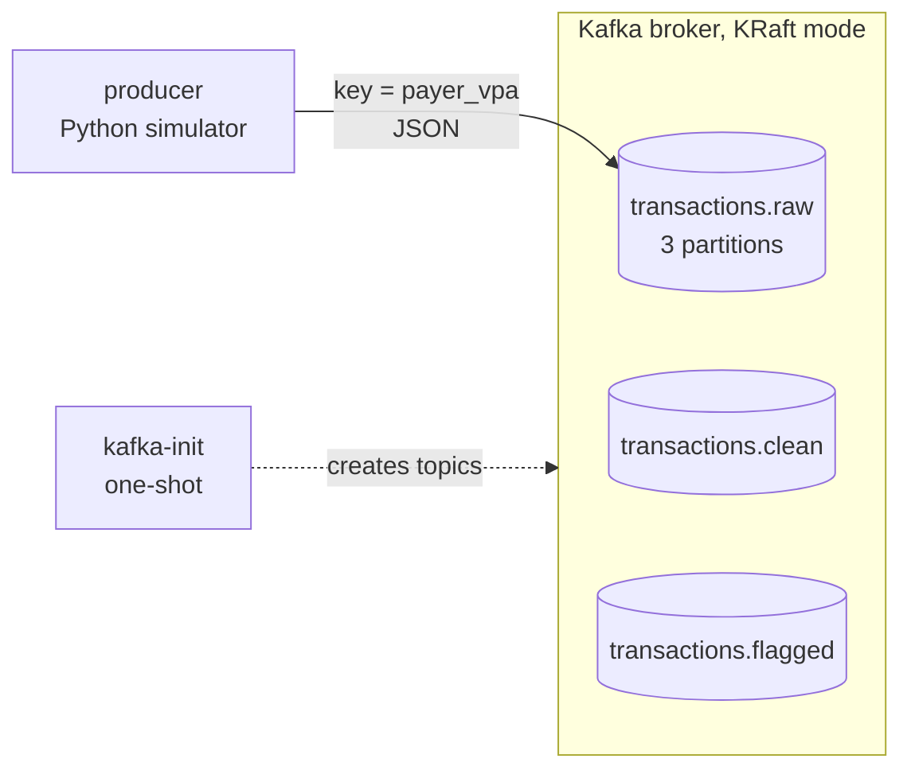

# Real-time UPI transaction pipeline with fraud detection

<!-- Shows what the project is and how to run it. It grows each phase; the full version comes in Phase 5. -->

A local, Docker-based streaming pipeline in the payments domain. A simulator produces UPI-style
transactions (including labelled fraud patterns and deliberately dirty records) into Kafka.
Later phases add cleaning, deduplication, PostgreSQL, an ML fraud model and a FastAPI service.

**Status:** Phase 1 of 5. Producer + Kafka (KRaft) are working.

## Architecture (Phase 1)



## Run

```bash
docker compose up --build        # add -d to run in the background
```

Optional: `cp .env.example .env` and edit it to change the rate, fraud/dirty rates or seed.

## See messages arriving

```bash
docker compose exec kafka /opt/kafka/bin/kafka-console-consumer.sh \
  --bootstrap-server localhost:9092 --topic transactions.raw \
  --property print.key=true --property print.partition=true

docker compose logs -f producer    # summary every 10 s: sent / delivered / fraud / dirty / rate
```

## Test

```bash
python3 -m venv .venv
.venv/bin/pip install -r requirements-dev.txt
.venv/bin/ruff check .
.venv/bin/pytest -v
```

## Measured so far (Phase 1, MacBook, Docker Desktop)

| What | Value | How to reproduce |
|---|---|---|
| Producer rate (configured 20 txn/s) | 20.0 txn/s, 3715 sent / 3715 delivered / 0 failed | `docker compose logs producer` |
| Memory: Kafka broker | 387 MiB | `docker stats --no-stream` |
| Memory: producer | 11 MiB | `docker stats --no-stream` |

Throughput and latency benchmarks come in Phase 5.
